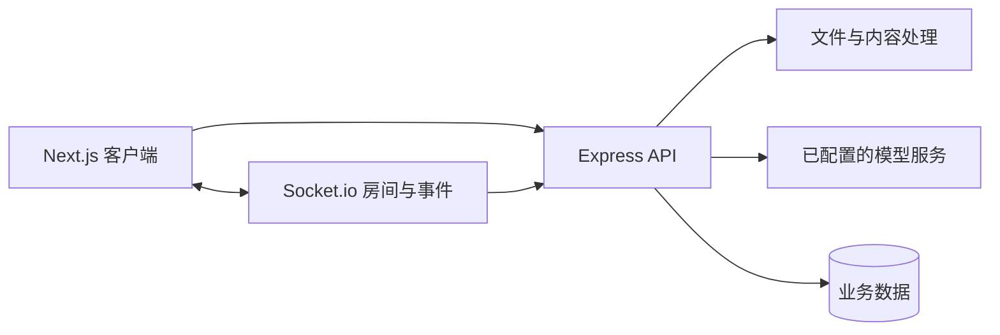

<div align="center">

# PopQuiz

把演讲材料转化为问题，用实时问答连接演讲者与听众。


[快速开始](#快速开始) · [工作空间](#工作空间) · [运行与验证](#运行与验证) · [数据与服务](#数据与服务)

</div>

PopQuiz 是演讲与教学互动项目。Next.js 界面、Express 服务和 Socket.io 组织内容处理、题目生成、答题与统计；数据库使用 Prisma 相关依赖。模型和文件处理能力还取决于配置、供应商及运行环境，不以依赖列表代替逐格式验收。

## 快速开始

```sh
git clone https://github.com/alanbulan/PopQuiz.git
cd PopQuiz
npm run setup
```

`setup` 是仓库实际提供的依赖安装入口，会依次安装根、client 和 server。先在隔离开发目录核对配置、数据库和模型服务，再启动：

```sh
npm run dev
```

根 dev 脚本通过 concurrently 同时启动客户端与服务端；访问地址以两个进程的输出和配置为准。安装脚本可能执行依赖安装钩子，不在生产目录直接试跑。

数据库初始化和 Prisma 迁移需要明确的开发数据库，不应为让项目启动而对现有库执行重置或未经检查的迁移。模型凭据只保存在服务端本机配置或受保护的 Secret 中。

## 工作空间



| 入口 | 职责 |
| --- | --- |
| [client](./client) | Next.js、React、UI 与实时通信客户端 |
| [server](./server) | API、认证、文件处理、题目及 Socket.io 服务 |
| [package.json](./package.json) | 根工作空间与串联脚本 |
| [client/package.json](./client/package.json) | 客户端构建、Jest、lint |
| [server/package.json](./server/package.json) | 服务端编译、启动、Jest 与文件处理检查 |

客户端 manifest 当前为 Next.js 14、React 18；服务端存在多种模型 SDK，不能将旧 README 的单一供应商描述当成唯一可用实现。版本是否需要升级，应结合兼容性和测试单独处理。

## 运行与验证

| 命令 | 当前含义 |
| --- | --- |
| `npm run dev` | 启动两端开发进程 |
| `npm run build` | 先构建 client，再编译 server |
| `npm test` | 依次调用 client/server 的 Jest 测试 |
| `npm start` | **只启动服务端**，不会同时启动 Next.js 客户端 |
| `npm run start --workspace=client` | 启动已构建的 Next.js 客户端 |
| `npm run lint --workspace=client` | 客户端 lint |
| `npm run lint --workspace=server` | 服务端 lint |

`clean` 使用类 Unix 的 `rm -rf`，`fresh-install` 会先删除多个依赖目录；它们不是跨平台通用的排错按钮，不要在不知道当前目录和副作用时运行。

建议以最小演讲材料验证上传、内容提取、题目发布、加入房间、断线重连、重复作答和统计一致性。音视频处理还需要相应系统工具，外部模型调用可能计费；测试脚本存在不等于全部测试已通过。

## 数据与服务

题目自动生成不保证正确，应有人工复核与错误反馈。参与者身份、答题记录和上传材料需要访问控制；不要用真实学生或客户的完整数据测试日志与第三方上传。

先用本机测试实例验证，再明确生产进程、静态资源、WebSocket 代理、文件大小限制和数据库备份。开发服务响应不代表持久化、模型和所有格式处理均健康。

2026-09-08 文档核对了根及两端 manifest，修正了占位克隆地址和启动范围；未安装依赖、运行测试、调用模型或发布服务。原长文与示例可通过 Git 历史查看，现有源码和许可文件不变。
